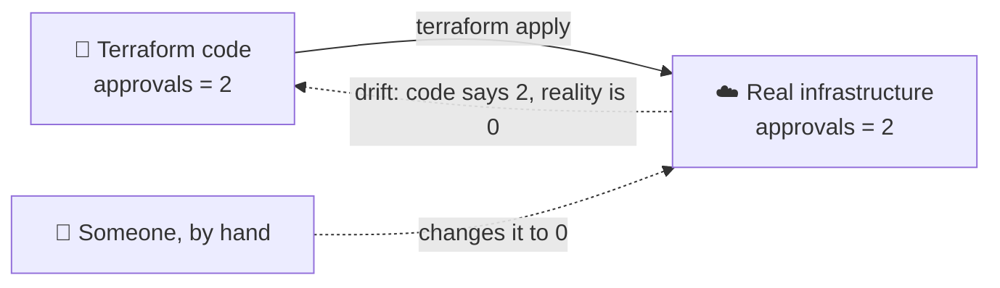
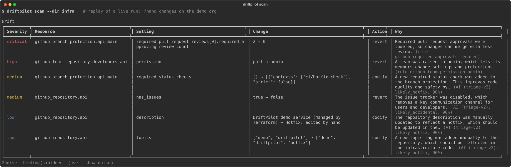
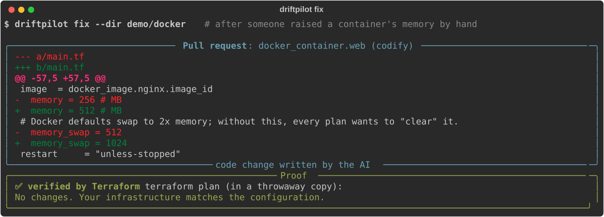
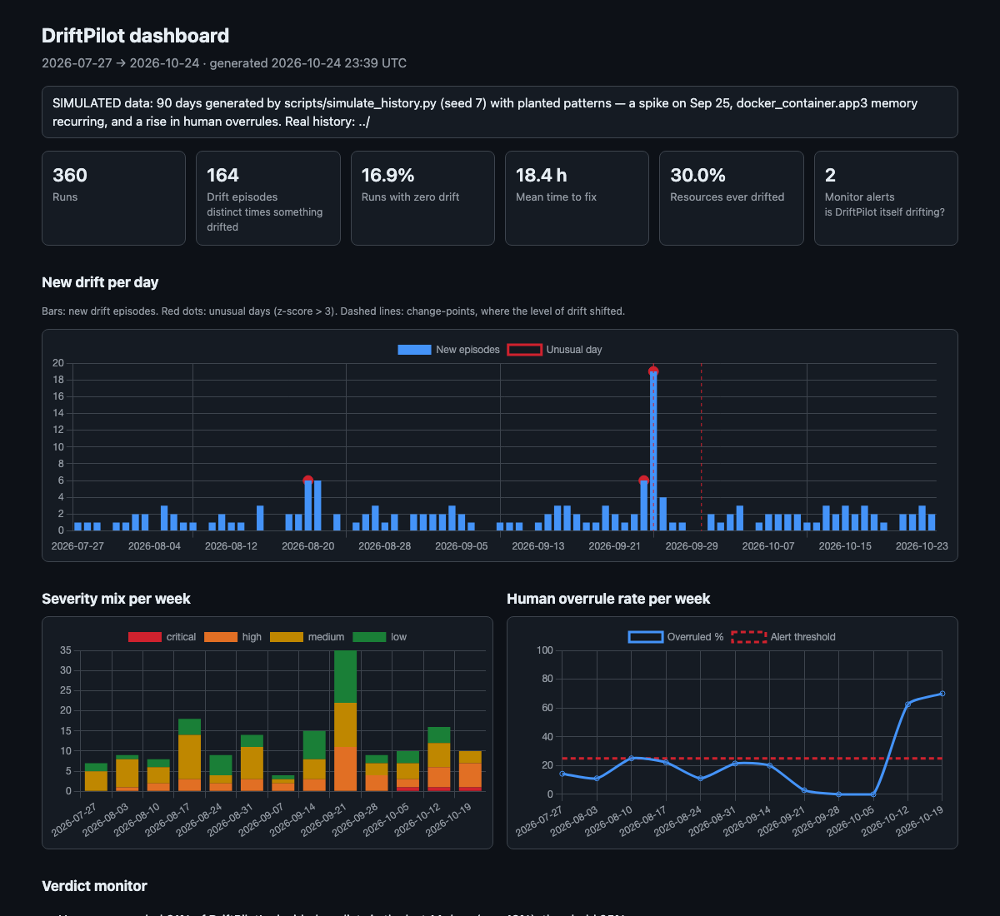
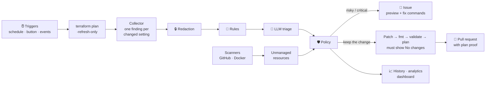
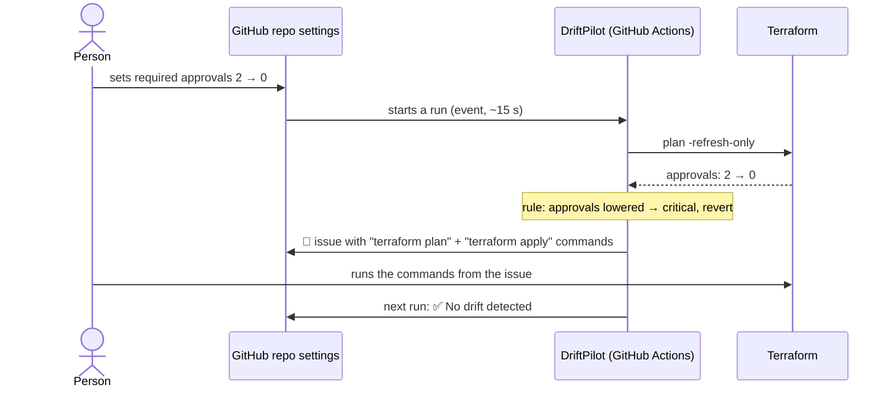
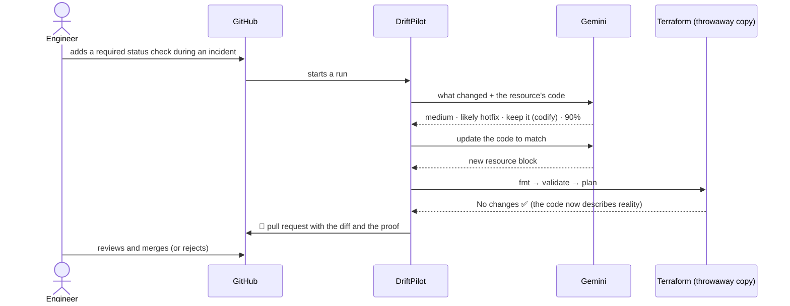

<p align="center">
  
</p>

<p align="center">
  <b>Catches Terraform drift, judges how much it matters, and proposes fixes that Terraform itself has proven correct.</b>
</p>

<p align="center">
  
  
  
  
  
  
</p>

<p align="center">
  <a href="#see-it-in-action">See it in action</a> ·
  <a href="#how-it-works">How it works</a> ·
  <a href="#results">Results</a> ·
  <a href="#use-it">Use it</a> ·
  <a href="https://driftpilot-demo.github.io/drift-dashboard/simulated/">Live dashboard</a>
</p>

---

## The problem

Teams describe their infrastructure (servers, databases, firewalls, repository settings, permissions) as
**Terraform code**, the blueprint. People still change the real thing by hand: an urgent fix during an outage, a
shortcut, a mistake. Reality then **drifts** away from the code.



Plain Terraform has four blind spots:

- **It only notices when someone runs `plan`.**
- **It can't see resources created outside it.**
- **It prints a raw diff with no judgment** about what's dangerous and what's noise.
- **The next `apply` can silently undo an emergency fix.**

## What DriftPilot does

| | Step | How |
| --- | --- | --- |
| 🔎 | **Detect** | Runs on a schedule, on demand, or seconds after a change. Asks Terraform what changed and scans for resources it doesn't manage. |
| ⚖️ | **Judge** | Rules filter noise and catch critical cases instantly. An LLM judges the rest: real or not, how severe, hotfix or mistake, keep or undo, and why. |
| 🛠️ | **Fix** | Dangerous change: an **issue** with the exact commands. Good change: a **pull request** whose code change is **proven by a zero-change `terraform plan`**. |
| 📈 | **Learn** | Keeps history, spots spikes and settings that keep drifting, tracks whether people accept its suggestions, and publishes a dashboard. |

DriftPilot **never changes infrastructure itself**. It proposes, and people decide.

## See it in action

**1. A scan.** Rules decide the obvious cases; the AI judges the rest and explains why. Noise is hidden.



<sub>Replay of a live run on the demo org: approvals lowered → critical (rule); team raised to admin → high (rule);
the other changes judged by Gemini. Reasons shortened for the image.</sub>

**2. A verified fix.** The AI writes the code change, and Terraform proves it in a throwaway copy before anyone sees
a pull request.



**3. Learning over time.** 90 days of simulated history with planted patterns. All of them are found: the spike
(red dot and change-point), the setting that keeps drifting, and people overruling DriftPilot more often.

<a href="https://driftpilot-demo.github.io/drift-dashboard/simulated/"></a>

In GitHub, the same results appear as a **job summary** on each run, plus **issues** and **pull requests** in the
repository.

## How it works



**Three layers of judgment**

| Layer | Role | Why |
| --- | --- | --- |
| **Rules** (`driftpilot/triage/rules/default.yaml`) | Filter known noise (provider defaults, API etags, runtime IPs, reordered lists, reformatted JSON). Always flag critical changes (protection or ruleset weakened, admin ports open to the internet…) | Instant, free, guaranteed |
| **LLM** (Gemini, prompt `triage-v2`) | Judges what rules don't decide: severity, intent, action, confidence, reason. One call per resource, secrets redacted, answer forced into a JSON schema | Context and explanations |
| **Policy** | Low confidence → a human investigates; critical → never an automatic PR; team settings always win | Safety |

### Story 1: someone weakens security



### Story 2: someone makes a good change



## Results

A fixed, labelled test set: **73 inputs, 135 findings** (72 real drift, 20 of them critical, plus 63 noise). It
covers all 14 demo scenarios, recordings from live runs, variants, and 25 AWS-style cases. The labels were written
before scoring. Full tables: [`eval/results/summary.md`](eval/results/summary.md).

| Setup | Noise filtered | Severity right | Critical caught | Action right | False alarms | LLM calls |
| --- | ---: | ---: | ---: | ---: | ---: | ---: |
| Raw Terraform | 0% | 0% | 0% | 0% | 100% | 0 |
| Rules only | 98% | 19% | 45% | 19% | 2% | 0 |
| **Rules + Gemini Flash-Lite** | **98%** | **89%** | **90%** | **92%** | **2%** | **52** |
| Gemini without rules | 98% | 89% | 90% | 92% | 2% | 76 |
| Rules + local LLM (Ollama) | not run on the 8 GB test machine | | | | | |

- **The LLM turns detection into judgment:** severity right rises from 19% to 89%.
- **The rules don't change accuracy on this set, but they:**
  - cut LLM calls by 32%
  - guarantee critical catches, even when the LLM is unavailable
- **Consistency:** the same answer in 5 of 5 repeats, on a 12-finding sample.
- **Where the LLM disagrees with the labels:** mostly it is more cautious, choosing `revert` where the labels also
  allow `codify`.
- **Live:**
  - event-driven detection in 10–18 s
  - verified fix PRs on the first attempt
  - every planted pattern found in the simulated history
- **Caveat:** labels and prompt were written by the same author.

### Proven on two repositories

| Repository | Terraform style | Live result |
| --- | --- | --- |
| `driftpilot-demo/infra` | Written for the demo (repos, branch protection, teams) | Hand change → run started by itself → critical issue → fixed → "No drift detected" |
| `driftpilot-demo/platform` | **Someone else's code**: the community module [`cloudposse/repository/github`](https://registry.terraform.io/modules/cloudposse/repository/github), using rulesets | Weakened ruleset → critical issue; description change → verified PR that edits the **module call** |

Running on someone else's code exposed six real problems, all fixed in v1:
- the scanner needed scoping when an org has several Terraform setups
- rulesets were unknown to the rules
- code inside a module couldn't be fixed directly
- a revert command broke when pasted into a shell
- module warnings cluttered the proof
- `-target` also touched dependencies, so issues now say to preview first

## Use it

### In a company: about 15 minutes, once

1. **Pick the repo that holds your Terraform code.** Application repos don't need anything.
2. **Make sure the GitHub runner can read your Terraform state** (e.g. an S3 or Terraform Cloud backend) and has
   read-only credentials for your provider (e.g. an AWS role via OIDC).
3. **Optional:** add a Gemini API key as the secret `LLM_API_KEY`. Without it, rules and reports still work.
4. **For pull requests:** enable **Settings → Actions → General → "Allow GitHub Actions to create and approve pull
   requests"**.
5. **Add this workflow:**

```yaml
name: DriftPilot
on:
  schedule:
    - cron: "17 */6 * * *"       # every 6 hours
  workflow_dispatch:              # "Run workflow" button
permissions:
  contents: write
  pull-requests: write
  issues: write
jobs:
  drift:
    runs-on: ubuntu-latest
    steps:
      - uses: actions/checkout@v4
      - uses: hashicorp/setup-terraform@v3
        with:
          terraform_wrapper: false
      - uses: shreytiwari09/DriftPilot-AI-Terraform-Drift-Detector@v1
        with:
          working-directory: infra/
          provider-token: ${{ secrets.INFRA_GITHUB_TOKEN }}   # credentials your Terraform provider needs
          llm-api-key: ${{ secrets.LLM_API_KEY }}
          mode: advise                                         # issues only; use open-prs for fix PRs
```

DriftPilot covers everything that repository's Terraform manages. With several Terraform repos, add it to each one
and use `include_names` so they don't report each other's resources.

| Input | Default | Purpose |
| --- | --- | --- |
| `working-directory` | `.` | Terraform folder |
| `provider-token` | | Credentials for the provider and scanners (passed as `GITHUB_TOKEN`) |
| `llm-api-key` | | Gemini key; without it, undecided findings stay "needs triage" |
| `llm-provider` / `llm-model` | `gemini` / pinned | `ollama` for a local model |
| `mode` | `advise` | `advise` (issues only) or `open-prs` |
| `config-path` | `.driftpilot.yml` | Repo settings |
| `history-branch` | `driftpilot-data` | Where history is stored |
| `dashboard-repo` / `dashboard-token` | | Public repo with GitHub Pages for the dashboard |

### Settings (`.driftpilot.yml`)

```yaml
mode: advise
confidence_threshold: 0.7
ignore: ["docker_container.*.restart"]
severity_overrides:
  - match: { type: "github_repository", attribute: "description" }
    severity: low
scanners:
  github:
    owner: my-org
    include_names: ["billing-*"]     # only the repos this Terraform owns
```

### On a laptop (CLI)

The same engine, for trying it out and debugging. It needs Terraform installed and your provider's credentials in
the shell.

```bash
pip install "git+https://github.com/shreytiwari09/DriftPilot-AI-Terraform-Drift-Detector@v1"
driftpilot scan --dir infra/          # drift table, noise hidden
driftpilot fix  --dir infra/          # the issues/PRs it would open, with verified patches
driftpilot report --history history/ --html site/   # analytics + dashboard
```

## Safety model

- 🚫 **Never applies.** It runs only `init`, `plan`, `show`, `validate` and `fmt`. People merge PRs or run the
  commands from an issue.
- 🔒 **Secrets stay out of prompts.** Sensitive values and anything that looks like a token or key are redacted
  before display or any LLM call.
- 🧾 **LLM output is never trusted raw.** It must match a strict schema; otherwise the verdict is `investigate`.
- ✅ **Every PR is proven.** `fmt`, `validate` and a `plan` showing no changes. Otherwise it becomes an issue labelled
  `unverified`.
- 🧑‍⚖️ **Critical drift goes to people.** Critical findings never get an automatic PR.

## Demo and evaluation

| What | Command |
| --- | --- |
| Inject or undo any of the 14 drift scenarios | `python scripts/inject_drift.py list \| inject N \| revert N` |
| Clickable demo console (local) | `pip install -e ".[demo]" && streamlit run demo/console/app.py` |
| Regenerate the results (cached LLM answers, no key needed) | `python eval/run_eval.py` |
| Dashboard from simulated history | `python scripts/simulate_history.py --out /tmp/h && driftpilot report --history /tmp/h --html /tmp/site` |

Live dashboards: [real history](https://driftpilot-demo.github.io/drift-dashboard/) ·
[simulated 90 days](https://driftpilot-demo.github.io/drift-dashboard/simulated/)

## Repository layout

```
action.yml               GitHub Action (composite)
driftpilot/
  collector.py           terraform plan -refresh-only → findings
  redact.py              strip secrets before display / LLM
  scanners/              GitHub and Docker resources outside Terraform
  triage/                rules (YAML), LLM triage + prompts, policy
  remediate/             codify / ignore_changes / import, verify, issues and PRs
  history/               history store, outcomes, analytics, verdict monitor
  report/                terminal, job summary, dashboard
  evaluation/            labelled-case scorer
demo/                    Docker and GitHub demo Terraform, demo console
scripts/                 drift injector, history simulator
eval/                    cases, results, cached LLM answers
tests/                   186 unit tests (no network) + recorded fixtures
```

## Limitations

- **Modules:** resources inside modules are fixed by editing the module call; `ignore_changes` can't be set from a
  call.
- **Imports:** some resources can't be imported without being recreated (e.g. a Docker container's `env`).
  Verification rejects these, and they become issues.
- **State:** the demo commits Terraform state to git. Real use needs a remote backend with locking.
- **Instant runs:** the demo uses a small relay workflow. In production that would be an org webhook or GitHub App,
  or CloudTrail with EventBridge on AWS.
- **AWS:** detection works through Terraform's plan, but hasn't been tried against a live AWS account.
- **Learning:** it tracks feedback but doesn't learn from it automatically yet.

## Roadmap

- **More platforms:**
  - AWS scanner, plus CloudTrail and EventBridge triggers
  - Azure, Google Cloud and Kubernetes
- **Smarter judgment:**
  - a classifier trained on accept/overrule decisions
  - noise rules suggested from repeated dismissals
  - independent evaluation labels
- **Easier for teams:**
  - a GitHub App (one-click, org-wide)
  - Marketplace and PyPI releases
  - Slack approvals
  - an "Apply Guardian" that warns when a PR would undo a hotfix

## Development

```bash
uv venv --python 3.12 && source .venv/bin/activate
uv pip install -e ".[dev]"
pytest                          # unit tests, no network
ruff check . && ruff format .
```
