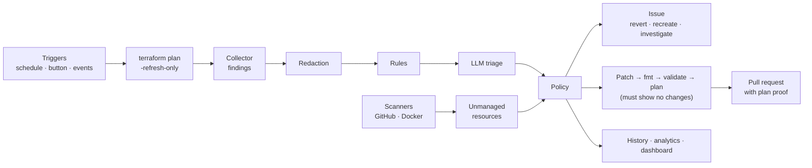

# DriftPilot

**A GitHub Action and Python CLI that catches Terraform drift, judges how much it matters, and proposes verified fixes.**

Teams describe their infrastructure in Terraform, but people still change things by hand: an urgent console fix, a
shortcut, a mistake. Reality then **drifts** from the code. Terraform only notices when someone runs `plan`, can't see
resources created outside it, prints a raw diff with no judgment, and the next `apply` may silently undo a hotfix.

DriftPilot closes those gaps:

1. **Detect**: on a schedule or the moment something changes; also finds resources created outside Terraform.
2. **Understand**: rules plus an LLM separate real drift from noise, rate severity, and infer intent (hotfix to
   keep or mistake to revert), with a plain-English reason.
3. **Fix**: opens an issue with the exact command to revert, or a pull request whose code change is **proven by a
   zero-change `terraform plan`**. It never runs `apply` itself.
4. **Learn**: keeps a history, finds recurring drift and unusual spikes, tracks whether people accept or overrule
   its verdicts, and publishes a dashboard.

Detection reads Terraform's plan JSON, so it works with any provider. The demos use GitHub and Docker (free).

## How it works



- **Rules first** (`driftpilot/triage/rules/default.yaml`): instant and free. They filter known noise (provider
  defaults, API etags, runtime IPs, reordered lists, reformatted JSON) and always catch critical cases (protection
  deleted or weakened, rulesets disabled, admin ports open to the internet).
- **LLM second**: only for what rules don't decide. One call per resource, with secrets redacted and the answer forced
  into a strict schema; an invalid answer is retried once, then becomes `investigate`.
- **Policy last**: low confidence goes to a human, critical drift never gets an automatic PR, and team settings
  (`ignore`, severity overrides, advise-only mode) always win.

## Results

On a fixed, labelled test set of 73 inputs: 135 findings, of which 72 are real drift (20 critical) and 63 are noise.
The labels were written before scoring. Full tables: [`eval/results/summary.md`](eval/results/summary.md).

| Setup | Noise filtered | Severity right | Critical caught | Action right | False alarms | LLM calls |
| --- | ---: | ---: | ---: | ---: | ---: | ---: |
| Raw Terraform | 0% | 0% | 0% | 0% | 100% | 0 |
| Rules only | 98% | 19% | 45% | 19% | 2% | 0 |
| **Rules + Gemini Flash-Lite** | **98%** | **89%** | **90%** | **92%** | **2%** | **52** |
| Gemini without rules | 98% | 89% | 90% | 92% | 2% | 76 |
| Rules + local LLM (Ollama) | not run (no local model on the test machine) | | | | | |

- On this set the rules don't change accuracy. They cut LLM calls by 32% and guarantee critical catches even when the
  LLM is unavailable.
- The LLM gave the same answer in 5 of 5 repeats on a 12-finding sample.
- Most misses are cautious: it chooses `revert` where the labels also allow `codify`.
- Live runs: verified fix PRs on the first attempt, and event-driven detection within 10–18 s.
- Analytics found every pattern planted in 90 days of simulated history.
- Caveat: the same author wrote the labels and the prompt.

## Quick start

### GitHub Action

```yaml
name: DriftPilot
on:
  schedule:
    - cron: "17 */6 * * *"
  workflow_dispatch:
permissions:
  contents: write
  pull-requests: write
  issues: write
jobs:
  drift:
    runs-on: ubuntu-latest
    steps:
      - uses: actions/checkout@v4
      - uses: hashicorp/setup-terraform@v3
        with:
          terraform_wrapper: false
      - uses: shreytiwari09/DriftPilot-AI-Terraform-Drift-Detector@v1
        with:
          working-directory: infra/
          provider-token: ${{ secrets.INFRA_GITHUB_TOKEN }}   # credentials your Terraform provider needs
          llm-api-key: ${{ secrets.LLM_API_KEY }}             # optional: Gemini API key
          mode: advise                                         # or open-prs
```

Findings appear in the job summary. In `open-prs` mode, verified fixes become pull requests. To let the workflow open
PRs, enable **Settings → Actions → General → "Allow GitHub Actions to create and approve pull requests"**.

| Input | Default | Purpose |
| --- | --- | --- |
| `working-directory` | `.` | Terraform folder |
| `provider-token` | | Credentials for the Terraform provider and scanners (passed as `GITHUB_TOKEN`) |
| `llm-api-key` | | Gemini API key; without it, undecided findings stay "needs triage" |
| `llm-provider` / `llm-model` | `gemini` / pinned default | `ollama` for a local model |
| `mode` | `advise` | `advise` (issues only) or `open-prs` |
| `config-path` | `.driftpilot.yml` | Repo settings |
| `history-branch` | `driftpilot-data` | Where drift history is stored |
| `dashboard-repo` / `dashboard-token` | | Public repo with GitHub Pages to publish the dashboard to |

### CLI

```bash
pip install "git+https://github.com/shreytiwari09/DriftPilot-AI-Terraform-Drift-Detector@v1"
export GEMINI_API_KEY=...                     # optional, or put it in a .env file
driftpilot scan --dir infra/                  # table of drift, noise hidden
driftpilot scan --dir infra/ --json
driftpilot fix --dir infra/                   # issues/PRs it would open, with verified patches (no GitHub calls)
driftpilot report --history history/ --html site/   # analytics + dashboard
```

### Configuration (`.driftpilot.yml`)

```yaml
mode: advise
confidence_threshold: 0.7
ignore:
  - "docker_container.*.restart"
severity_overrides:
  - match: { type: "github_repository", attribute: "description" }
    severity: low
llm:
  provider: gemini        # or ollama
  model: gemini-3.1-flash-lite
scanners:
  github:
    owner: my-org
    include_names: ["billing-*"]   # several Terraform setups in one org: scan only yours
    ignore_names: ["sandbox"]
  docker:
    managed_label: "managed-by=terraform"
```

## Safety model

- **Never applies.** DriftPilot runs only `init`, `plan`, `show`, `validate` and `fmt`. Changes reach infrastructure
  only when a person merges a PR or runs the command from an issue.
- **Secrets stay out of prompts.** Values Terraform marks sensitive, plus anything that looks like a token or key, are
  redacted before display or any LLM call. Codify refuses changes to redacted values.
- **LLM output is never trusted raw.** It must parse as the schema; otherwise the verdict becomes `investigate`.
- **Every PR is proven.** The patch is applied in a throwaway copy and must pass `fmt`, `validate` and a `plan` with
  no changes. If it can't be verified, it becomes an issue labelled `unverified`.
- **Critical drift goes to people.** Critical findings never get an automatic PR.

## Demo and evaluation

- `scripts/inject_drift.py list|inject N|revert N` runs the 14 drift scenarios (GitHub API / Docker SDK).
- `python eval/run_eval.py` regenerates the results. LLM answers are cached in `eval/cache/`, so no key is needed.
- `python scripts/simulate_history.py --out /tmp/h && driftpilot report --history /tmp/h --html /tmp/site` builds a
  dashboard from 90 days of simulated history.
- Live dashboards: [real history](https://driftpilot-demo.github.io/drift-dashboard/) ·
  [simulated 90 days](https://driftpilot-demo.github.io/drift-dashboard/simulated/).

## Limitations

- Resources inside modules are fixed by editing the module call. `ignore_changes` can't be set from a call.
- Importing some resources isn't possible without recreating them; for example, a Docker container whose `env`
  isn't readable. Verification rejects these, and they become issues.
- The demo commits Terraform state to git. Real use needs a remote backend with locking; committed state can race
  with event-driven runs.
- Instant runs need an event source. The demo uses a small relay workflow; in production that would be an org webhook
  or GitHub App, or CloudTrail with EventBridge on AWS.
- The evaluation labels were written by the author, not independently.

## Roadmap (Version 2)

AWS scanners and event triggers, a classifier trained on human outcomes, an "Apply Guardian" that warns when a PR would
undo a manual hotfix, audit-log enrichment, cost impact, policy-as-code, Slack approvals, more providers.

## Development

```bash
uv venv --python 3.12 && source .venv/bin/activate
uv pip install -e ".[dev]"
pytest            # unit tests, no network
ruff check . && ruff format .
```
